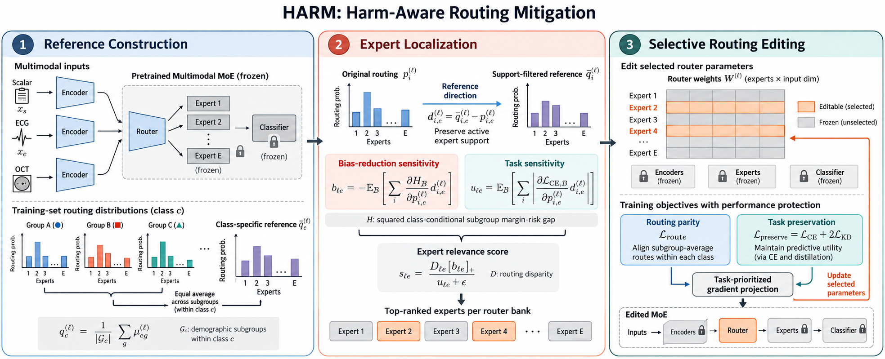

# HARM

**Harm-Aware Routing Mitigation for Fair Medical Multimodal Mixture-of-Experts Classification**

HARM improves the balance between demographic fairness and predictive performance in multimodal medical mixture-of-experts (MoE) models by selectively editing their routers.

## Motivation

MoE routers assign different inputs to specialized experts. Our motivating experiments show that balancing expert allocation across demographic groups can reduce both routing disparities and subgroup prediction disparities, but can also lower classification performance. This motivates targeted interventions that reduce harmful routing patterns while preserving useful expert specialization.

## Method

HARM consists of three stages:

1. **Class-conditional reference construction:** Build balanced reference routes by equally averaging subgroup routing distributions within each class.
2. **Harm-aware localization:** Identify routing components whose modification is expected to reduce subgroup harm with limited impact on task performance.
3. **Selective router editing with performance protection:** Update selected router parameters using routing parity, supervised learning, prediction distillation, and task-prioritized gradient projection. Encoders, experts, and the classifier remain frozen.

## Experiments

We evaluate HARM on three medical classification tasks: diabetes classification with **AI-READI**, sepsis prediction with **PhysioNet 2019**, and sleep-stage classification with **Sleep-EDF**. Experiments cover four MoE architectures—Scalable MoE, FlexMoE, MELON, and μMoE—and assess demographic disparities associated with `Age` and `Sex`.

HARM achieves a favorable trade-off between outcome fairness and classification performance compared with direct routing interventions. Ablations show that harm-aware localization improves component selection and that performance protection helps retain classification performance during editing.

## Project status

Experiments and manuscript preparation are complete.
